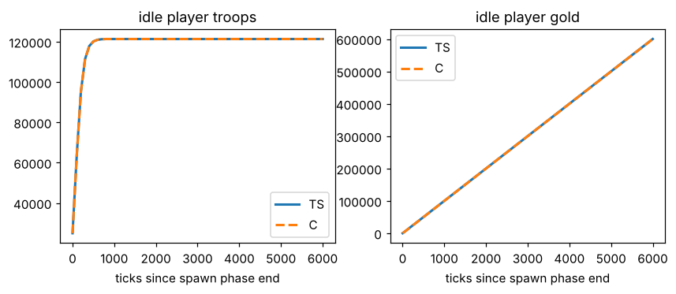
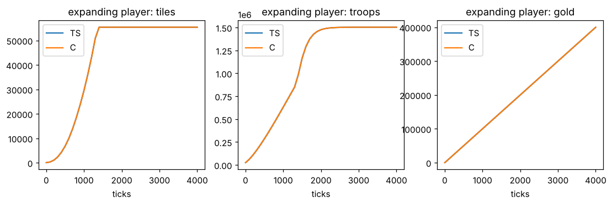
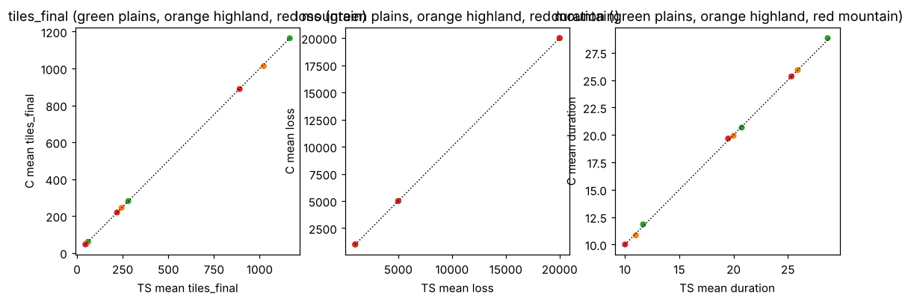
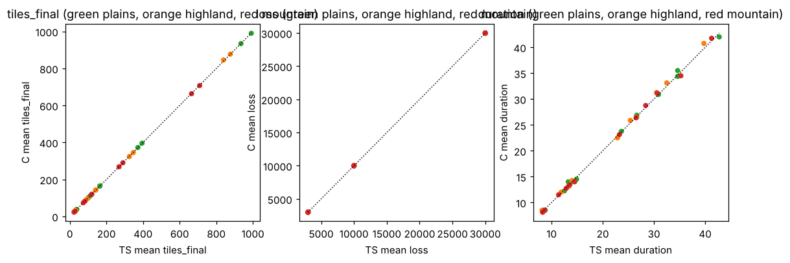
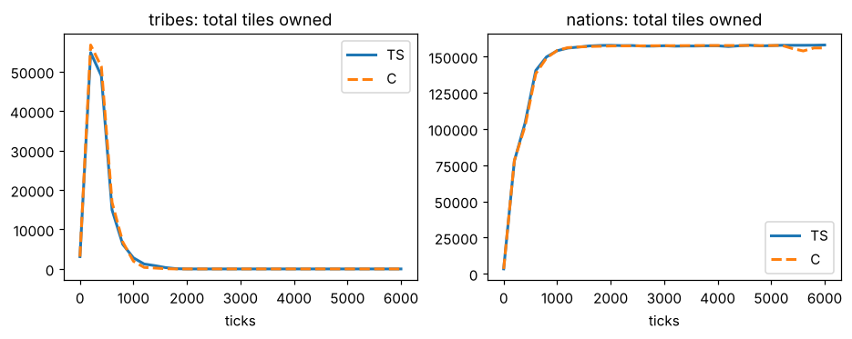
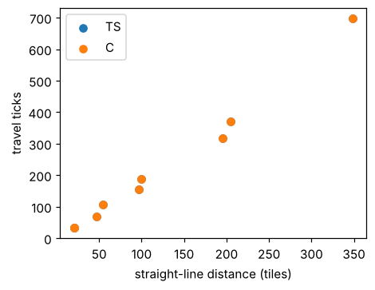

# Fidelity report: C engine vs OpenFront TypeScript engine

Generated by `tools/fidelity/compare.py` (2026-11-07); OpenFront commit `1f6f7e3`; map `world` (compact), 12 seeds. C `OFE_RULES_VERSION=1`.

## Summary of flagged metrics

| section | metric | verdict | Δ mean | note |
|---|---|---|---|---|
| ai | tribe pooled tiles per alive player @ t=6000 | n/a | - |  |

`verdict`: DIFF = |Δ mean| over the section's tolerance and z > 3; warn = z > 3 but small; ok = indistinguishable at this sample size.

Scope: world map (compact, 1000x500). The single-player scenarios (idle, expand, land attacks, structures, enclaves,
boats) start both engines from one scenario script (same spawn tile, then explicit tile / troop / gold setup), 8-20
seeds each, with a per-seed offset of up to 6 tiles so both engines have a comparable spread (the TS engine is
deterministic for a given geometry). The AI section runs 60 tribes and the map's 72 nations with no humans for 6000
ticks (Medium difficulty, 6 seeds; spawn positions are random in both engines, so only distributions compare).
Nukes, rail, doomsday, embargoes and team games exist in C but are not scripted in the comparison.

**What matches**

| Area | Result |
|---|---|
| Idle player troop and gold growth, 6000 ticks | bit-identical |
| Spawn: tiles, troops, gold for 12 humans; spawn phase length (tick 202) | identical |
| Expanding player (attack on terra nullius every 10 s), t=100..4000 | tiles within 1%, troops +0.2% |
| Land attack on terra nullius, 9 cells | tiles conquered: median delta 0.0%, p90 0.3% |
| Land attack on a player, 36 cells | tiles conquered: median +0.6%, p90 1.9%, worst cell +2.8% |
| Wiping out an 80-tile player; enclave annexation; city and defense post | identical or within 0.2% |
| Boat travel time, 10 routes (25 to 350 tiles) | identical on every route (per-route C/TS ratio 1.000; boat_d350_0 lands in neither within 700 ticks); ships use OpenFront's own water pathfinder |
| Nation spawn size at t=0 | 46.6 vs 47.2 tiles per nation (C used to give a fixed 49.9) |
| Tribes alive at t=600 | 14.5 vs 12.5 (was 23 vs 12.5); all gone by t=2400 in both |
| Nation land at t=600 / t=6000 | 139k vs 140k / 156k vs 158k tiles; nations alive at t=6000: 13.5 vs 12.5 |
| Leader's land share at t=6000 | 0.33 vs 0.41 (n=6, std 0.13: not distinguishable) |

**What changed since the first report (and why it mattered)**

* Tick ordering (the old discrepancies 1 to 4: attack start, regeneration vs attack, spawn phase length, enclave
  latency) is fixed and the idle/expand/attack numbers above are exact or within a percent.
* Nation timing was the cause of the "tribes die slower in C" gap. OpenFront builds a nation's behaviours and sends its
  opening attack on the very first tick after the spawn phase, and from then on its full decisions fall on ticks where
  `tick % rate == offset` (structure-only turns at 1/3 and 2/3 of the period). C started the opening on a random
  tick in the first period and its first real decision one period after that, so nations began taking tribe land about
  60 ticks late. Both now follow the TS schedule.
* Nation spawns: tribes are placed first, nations then pick a random free land tile within 25 tiles of their map spot
  (half of the mountain tiles are skipped) and hop to a new spot on every beat during the spawn phase, so their discs
  are cut short by tribes that were already there. An explicit spawn tile is never swapped for a random one.
* AI alliance answers are given on the AI's own turn (OpenFront's AIs look at their inbox only when they wake up):
  nations reject everything asked during the spawn phase, tribes accept everything, and neither asks to extend an
  alliance on its own (only an agent's extension ask is answered).
* Ship routing is OpenFront's own water pathfinder in both builds (`engine/src/pathfind_ts.c`: mini map from
  `map4x.bin`/`map16x.bin`, hierarchical A*, smoothing, shore coercing; verified tile for tile against TS). It
  replaces the weighted grid A* with string pulling and its full-resolution strait fallback, which were slower and gave
  routes that differed by tens of percent (boat_d50_1: 74 vs 107 ticks, boat_d200_1: 414 vs 371). Launch and retreat
  shores follow `closestShoreByWater` (route-based, with `refineStartTile`), water bodies are `getWaterComponent`.
  Straits, the Bering route (about 700 ticks) and all 297 random shore pairs of the world test are routable. Routes are
  memoised per map; ships hold a stepper (`WaterPathFinder.next`) in the unit table.
* A cancelled transport ship sails to the nearest own shore by water, as in OpenFront (25% of the troops lost on
  arrival), not back along its route.

**Remaining differences (not fixed)**

1. Warship and trade-ship choices (target selection, port capacity) are simpler; only boats are compared here. Their
   routes are exact, their decisions are not (the leader-land-share row of the AI section has n=6 and flags at some
   checkpoints from run to run; it is sampling noise there).
2. Nations do not use OpenFront's walled-in-bot annexation planner (Hard and Impossible only), their boat targets are
   not checked against hostile warships, and "largest cluster" boxes are the border bounding box. Medium is what the
   comparison runs.
3. MIRV targeting and nuke trajectories are sampled and SAM interception is judged by range of the blast, not by the
   trajectory; no nuke price memory or strike follow-ups for nations. A 20-minute Impossible world game launches about
   250 nukes in C; there is no TS number to compare it with yet.
4. Enclave annexation uses no diagonal-pinch pass (nuke craters).
5. No emojis, no tutorial logic, no team-spawn areas.
6. Random draws are not reproduced: only distributions can be compared, and with 6 seeds the AI rows have wide
   confidence intervals (leader share, nations alive at t=6000).

## 1. Idle player: troop and gold curves

One human spawns on plains and does nothing for 6000 ticks (10 min). Both engines are deterministic here, so the curves should coincide exactly.

| tick | TS troops | C troops | TS gold | C gold | TS tiles | C tiles |
|---|---|---|---|---|---|---|
| 0 | 25,000 | 25,000 | 0 | 0 | 52.00 | 52.00 |
| 100 | 63,295 | 63,295 | 10,000 | 10,000 | 52.00 | 52.00 |
| 600 | 120,938 | 120,938 | 60,000 | 60,000 | 52.00 | 52.00 |
| 1200 | 121,318 | 121,318 | 120,000 | 120,000 | 52.00 | 52.00 |
| 2400 | 121,318 | 121,318 | 240,000 | 240,000 | 52.00 | 52.00 |
| 4200 | 121,318 | 121,318 | 420,000 | 420,000 | 52.00 | 52.00 |
| 6000 | 121,318 | 121,318 | 600,000 | 600,000 | 52.00 | 52.00 |

Worst relative difference over the whole curve (mean over seeds): troops 0.00e+00, gold 0.00e+00, tiles 0.00e+00.

## 2. Expanding player (attacks terra nullius every 10 s with the default 1/5 of troops)

| metric | n | TS mean | TS std | C mean | C std | Δ mean | KS D | KS p | verdict |
|---|---|---|---|---|---|---|---|---|---|
| tiles @ t=100 | 12 | 337.2 | 11.29 | 338.0 | 12.92 | +0.2% | 0.17 | 0.99 | ok |
| troops @ t=100 | 12 | 61,906 | 124.1 | 61,914 | 134.7 | +0.0% | 0.17 | 0.99 | ok |
| gold @ t=100 | 12 | 10,000 | 0 | 10,000 | 0 | +0.0% | 0 | 1.00 | ok |
| tiles @ t=500 | 12 | 6,828 | 45.28 | 6,833 | 51.56 | +0.1% | 0.25 | 0.79 | ok |
| troops @ t=500 | 12 | 285,883 | 803.2 | 285,980 | 848.6 | +0.0% | 0.25 | 0.79 | ok |
| gold @ t=500 | 12 | 50,000 | 0 | 50,000 | 0 | +0.0% | 0 | 1.00 | ok |
| tiles @ t=1000 | 12 | 29,613 | 81.10 | 29,616 | 87.90 | +0.0% | 0.17 | 0.99 | ok |
| troops @ t=1000 | 12 | 632,156 | 1,080 | 632,248 | 1,228 | +0.0% | 0.25 | 0.79 | ok |
| gold @ t=1000 | 12 | 100,000 | 0 | 100,000 | 0 | +0.0% | 0 | 1.00 | ok |
| tiles @ t=2000 | 12 | 55,419 | 0 | 55,419 | 0 | +0.0% | 0 | 1.00 | ok |
| troops @ t=2000 | 12 | 1,476,486 | 175.7 | 1,476,521 | 198.2 | +0.0% | 0.25 | 0.79 | ok |
| gold @ t=2000 | 12 | 200,000 | 0 | 200,000 | 0 | +0.0% | 0 | 1.00 | ok |
| tiles @ t=4000 | 12 | 55,419 | 0 | 55,419 | 0 | +0.0% | 0 | 1.00 | ok |
| troops @ t=4000 | 12 | 1,503,356 | 0 | 1,503,356 | 0 | +0.0% | 0 | 1.00 | ok |
| gold @ t=4000 | 12 | 400,000 | 0 | 400,000 | 0 | +0.0% | 0 | 1.00 | ok |

## 3. Land attacks on terra nullius

A 40x40 block (1600 tiles, 40k troops) attacks the free land around it with a fixed number of troops, on plains / highland / mountain arenas. Tiles gained after 30 / 100 ticks and at the end (400 ticks), attacker troops lost, attack duration, and the share of games in which the attack finished (`done`).

Per-metric summary over all cells (relative difference of the C mean to the TS mean):

| metric | cells | median Δ | p90 |Δ| | cells DIFF | cells warn |
|---|---|---|---|---|---|
| tiles_t30 | 9 | -0.2% | 1.0% | 0 | 0 |
| tiles_t100 | 9 | -0.2% | 1.0% | 0 | 0 |
| tiles_final | 9 | -0.2% | 1.0% | 0 | 0 |
| loss | 9 | +0.0% | 0.0% | 0 | 0 |
| loss_per_tile | 9 | +0.2% | 1.0% | 0 | 0 |
| duration | 9 | +0.0% | 1.4% | 0 | 0 |
| done | 9 | +0.0% | 0.0% | 0 | 0 |

per-cell `tiles_final`

| cell | n | TS mean | TS std | C mean | C std | Δ mean | KS D | KS p | verdict |
|---|---|---|---|---|---|---|---|---|---|
| tn_plains_x1000 | 12 | 60.17 | 0.577 | 60.00 | 0.953 | -0.3% | 0.25 | 0.79 | ok |
| tn_plains_x5000 | 12 | 280.4 | 5.53 | 280.8 | 4.88 | +0.1% | 0.17 | 0.99 | ok |
| tn_plains_x20000 | 12 | 1,165 | 11.56 | 1,164 | 11.03 | -0.1% | 0.25 | 0.79 | ok |
| tn_highland_x1000 | 12 | 51.25 | 0.866 | 50.75 | 1.06 | -1.0% | 0.25 | 0.79 | ok |
| tn_highland_x5000 | 12 | 244.5 | 3.21 | 244.7 | 3.23 | +0.1% | 0.17 | 0.99 | ok |
| tn_highland_x20000 | 12 | 1,022 | 19.23 | 1,013 | 24.59 | -0.9% | 0.33 | 0.43 | ok |
| tn_mountain_x1000 | 12 | 45.92 | 0.669 | 45.67 | 0.888 | -0.5% | 0.17 | 0.99 | ok |
| tn_mountain_x5000 | 12 | 219.4 | 1.78 | 219.4 | 1.93 | +0.0% | 0.17 | 0.99 | ok |
| tn_mountain_x20000 | 12 | 890.4 | 6.58 | 888.7 | 5.68 | -0.2% | 0.25 | 0.79 | ok |

per-cell `loss`

| cell | n | TS mean | TS std | C mean | C std | Δ mean | KS D | KS p | verdict |
|---|---|---|---|---|---|---|---|---|---|
| tn_plains_x1000 | 12 | 1,000 | 0 | 1,000 | 0 | +0.0% | 0 | 1.00 | ok |
| tn_plains_x5000 | 12 | 5,000 | 0 | 5,000 | 0 | +0.0% | 0 | 1.00 | ok |
| tn_plains_x20000 | 12 | 20,000 | 0 | 20,000 | 0 | +0.0% | 0 | 1.00 | ok |
| tn_highland_x1000 | 12 | 1,000 | 0 | 1,000 | 0 | +0.0% | 0 | 1.00 | ok |
| tn_highland_x5000 | 12 | 5,000 | 0 | 5,000 | 0 | +0.0% | 0 | 1.00 | ok |
| tn_highland_x20000 | 12 | 20,000 | 0 | 20,000 | 0 | +0.0% | 0 | 1.00 | ok |
| tn_mountain_x1000 | 12 | 1,000 | 0 | 1,000 | 0 | +0.0% | 0 | 1.00 | ok |
| tn_mountain_x5000 | 12 | 5,000 | 0 | 5,000 | 0 | +0.0% | 0 | 1.00 | ok |
| tn_mountain_x20000 | 12 | 20,000 | 0 | 20,000 | 0 | +0.0% | 0 | 1.00 | ok |

per-cell `duration`

| cell | n | TS mean | TS std | C mean | C std | Δ mean | KS D | KS p | verdict |
|---|---|---|---|---|---|---|---|---|---|
| tn_plains_x1000 | 12 | 11.67 | 0.492 | 11.83 | 0.389 | +1.4% | 0.17 | 0.99 | ok |
| tn_plains_x5000 | 12 | 20.75 | 0.452 | 20.67 | 0.492 | -0.4% | 0.083 | 1 | ok |
| tn_plains_x20000 | 12 | 28.67 | 0.492 | 28.83 | 0.577 | +0.6% | 0.083 | 1 | ok |
| tn_highland_x1000 | 12 | 11.00 | 0 | 10.83 | 0.389 | -1.5% | 0.17 | 0.99 | ok |
| tn_highland_x5000 | 12 | 20.00 | 0 | 19.92 | 0.289 | -0.4% | 0.083 | 1 | ok |
| tn_highland_x20000 | 12 | 25.92 | 0.289 | 25.92 | 0.289 | +0.0% | 0 | 1.00 | ok |
| tn_mountain_x1000 | 12 | 10.00 | 0 | 10.00 | 0 | +0.0% | 0 | 1.00 | ok |
| tn_mountain_x5000 | 12 | 19.50 | 0.522 | 19.67 | 0.492 | +0.9% | 0.17 | 0.99 | ok |
| tn_mountain_x20000 | 12 | 25.33 | 0.778 | 25.33 | 0.651 | +0.0% | 0.083 | 1 | ok |

## 4. Land attacks on a player

A 2400-tile attacker (40k troops) hits an adjacent defender block (1200 or 2400 tiles, 4k or 20k troops) with 3k / 10k / 30k troops, on three terrain types, after the 50-tick spawn immunity.

Per-metric summary over all cells (relative difference of the C mean to the TS mean):

| metric | cells | median Δ | p90 |Δ| | cells DIFF | cells warn |
|---|---|---|---|---|---|
| tiles_t30 | 36 | +0.1% | 0.8% | 0 | 0 |
| tiles_t100 | 36 | +0.1% | 0.7% | 0 | 0 |
| tiles_final | 36 | +0.1% | 0.7% | 0 | 0 |
| loss | 36 | +0.0% | 0.0% | 0 | 0 |
| loss_per_tile | 36 | -0.1% | 0.7% | 0 | 0 |
| duration | 36 | +0.0% | 3.1% | 0 | 0 |
| done | 36 | +0.0% | 0.0% | 0 | 0 |

per-cell `tiles_final`

| cell | n | TS mean | TS std | C mean | C std | Δ mean | KS D | KS p | verdict |
|---|---|---|---|---|---|---|---|---|---|
| pvp_plains_d1200_D4000_x3000 | 8 | 37.12 | 0.354 | 37.25 | 0.707 | +0.3% | 0.25 | 0.93 | ok |
| pvp_plains_d1200_D4000_x10000 | 8 | 163.8 | 1.75 | 163.9 | 1.81 | +0.1% | 0.25 | 0.93 | ok |
| pvp_plains_d1200_D4000_x30000 | 8 | 991.2 | 22.81 | 989.5 | 21.96 | -0.2% | 0.25 | 0.93 | ok |
| pvp_plains_d1200_D20000_x3000 | 8 | 32.00 | 0 | 32.00 | 0.535 | +0.0% | 0.12 | 1 | ok |
| pvp_plains_d1200_D20000_x10000 | 8 | 99.88 | 1.25 | 99.75 | 1.67 | -0.1% | 0.12 | 1 | ok |
| pvp_plains_d1200_D20000_x30000 | 8 | 371.8 | 4.95 | 370.9 | 4.32 | -0.2% | 0.12 | 1 | ok |
| pvp_plains_d2400_D4000_x3000 | 8 | 38.00 | 0 | 38.00 | 0.535 | +0.0% | 0.12 | 1 | ok |
| pvp_plains_d2400_D4000_x10000 | 8 | 164.8 | 1.75 | 165.4 | 1.30 | +0.4% | 0.38 | 0.52 | ok |
| pvp_plains_d2400_D4000_x30000 | 8 | 934.8 | 9.95 | 936.5 | 7.17 | +0.2% | 0.38 | 0.52 | ok |
| pvp_plains_d2400_D20000_x3000 | 8 | 35.00 | 0 | 35.12 | 0.641 | +0.4% | 0.25 | 0.93 | ok |
| pvp_plains_d2400_D20000_x10000 | 8 | 109.9 | 1.73 | 110.1 | 1.73 | +0.2% | 0.12 | 1 | ok |
| pvp_plains_d2400_D20000_x30000 | 8 | 394.6 | 4.34 | 394.4 | 4.98 | -0.1% | 0.12 | 1 | ok |
| pvp_highland_d1200_D4000_x3000 | 8 | 31.75 | 0.707 | 31.88 | 0.991 | +0.4% | 0.12 | 1 | ok |
| pvp_highland_d1200_D4000_x10000 | 8 | 140.4 | 3.81 | 141.5 | 4.57 | +0.8% | 0.38 | 0.52 | ok |
| pvp_highland_d1200_D4000_x30000 | 8 | 877.0 | 12.57 | 877.8 | 13.46 | +0.1% | 0.12 | 1 | ok |
| pvp_highland_d1200_D20000_x3000 | 8 | 27.62 | 0.518 | 27.50 | 0.926 | -0.5% | 0.12 | 1 | ok |
| pvp_highland_d1200_D20000_x10000 | 8 | 86.88 | 1.89 | 86.88 | 1.81 | +0.0% | 0.12 | 1 | ok |
| pvp_highland_d1200_D20000_x30000 | 8 | 325.2 | 10.04 | 323.5 | 10.36 | -0.5% | 0.38 | 0.52 | ok |
| pvp_highland_d2400_D4000_x3000 | 8 | 32.62 | 0.916 | 32.62 | 1.06 | +0.0% | 0.12 | 1 | ok |
| pvp_highland_d2400_D4000_x10000 | 8 | 142.6 | 3.85 | 143.1 | 4.32 | +0.4% | 0.25 | 0.93 | ok |
| pvp_highland_d2400_D4000_x30000 | 8 | 839.5 | 15.11 | 846.0 | 18.45 | +0.8% | 0.38 | 0.52 | ok |
| pvp_highland_d2400_D20000_x3000 | 8 | 30.38 | 0.916 | 30.25 | 0.886 | -0.4% | 0.12 | 1 | ok |
| pvp_highland_d2400_D20000_x10000 | 8 | 95.62 | 1.77 | 96.12 | 1.64 | +0.5% | 0.38 | 0.52 | ok |
| pvp_highland_d2400_D20000_x30000 | 8 | 346.9 | 9.23 | 346.2 | 8.56 | -0.2% | 0.38 | 0.52 | ok |
| pvp_mountain_d1200_D4000_x3000 | 8 | 26.75 | 0.463 | 27.00 | 0.535 | +0.9% | 0.12 | 1 | ok |
| pvp_mountain_d1200_D4000_x10000 | 8 | 118.4 | 1.06 | 118.5 | 1.07 | +0.1% | 0.12 | 1 | ok |
| pvp_mountain_d1200_D4000_x30000 | 8 | 709.2 | 6.32 | 705.1 | 4.32 | -0.6% | 0.5 | 0.19 | ok |
| pvp_mountain_d1200_D20000_x3000 | 8 | 23.00 | 0 | 23.12 | 0.354 | +0.5% | 0.12 | 1 | ok |
| pvp_mountain_d1200_D20000_x10000 | 8 | 73.88 | 0.641 | 74.25 | 1.04 | +0.5% | 0.25 | 0.93 | ok |
| pvp_mountain_d1200_D20000_x30000 | 8 | 268.9 | 2.30 | 269.0 | 2.07 | +0.0% | 0.25 | 0.93 | ok |
| pvp_mountain_d2400_D4000_x3000 | 8 | 27.38 | 0.518 | 27.50 | 0.535 | +0.5% | 0.12 | 1 | ok |
| pvp_mountain_d2400_D4000_x10000 | 8 | 120.2 | 0.707 | 120.2 | 1.04 | +0.0% | 0.12 | 1 | ok |
| pvp_mountain_d2400_D4000_x30000 | 8 | 665.0 | 4.93 | 661.5 | 3.02 | -0.5% | 0.62 | 0.05 | ok |
| pvp_mountain_d2400_D20000_x3000 | 8 | 25.25 | 0.463 | 25.50 | 0.535 | +1.0% | 0.25 | 0.93 | ok |
| pvp_mountain_d2400_D20000_x10000 | 8 | 81.88 | 0.641 | 81.88 | 0.641 | +0.0% | 0 | 1.00 | ok |
| pvp_mountain_d2400_D20000_x30000 | 8 | 289.8 | 2.05 | 290.4 | 2.72 | +0.2% | 0.25 | 0.93 | ok |

per-cell `loss`

| cell | n | TS mean | TS std | C mean | C std | Δ mean | KS D | KS p | verdict |
|---|---|---|---|---|---|---|---|---|---|
| pvp_plains_d1200_D4000_x3000 | 8 | 3,000 | 0 | 3,000 | 0 | +0.0% | 0 | 1.00 | ok |
| pvp_plains_d1200_D4000_x10000 | 8 | 10,000 | 0 | 10,000 | 0 | +0.0% | 0 | 1.00 | ok |
| pvp_plains_d1200_D4000_x30000 | 8 | 30,000 | 0 | 30,000 | 0 | +0.0% | 0 | 1.00 | ok |
| pvp_plains_d1200_D20000_x3000 | 8 | 3,000 | 0 | 3,000 | 0 | +0.0% | 0 | 1.00 | ok |
| pvp_plains_d1200_D20000_x10000 | 8 | 10,000 | 0 | 10,000 | 0 | +0.0% | 0 | 1.00 | ok |
| pvp_plains_d1200_D20000_x30000 | 8 | 30,000 | 0 | 30,000 | 0 | +0.0% | 0 | 1.00 | ok |
| pvp_plains_d2400_D4000_x3000 | 8 | 3,000 | 0 | 3,000 | 0 | +0.0% | 0 | 1.00 | ok |
| pvp_plains_d2400_D4000_x10000 | 8 | 10,000 | 0 | 10,000 | 0 | +0.0% | 0 | 1.00 | ok |
| pvp_plains_d2400_D4000_x30000 | 8 | 30,000 | 0 | 30,000 | 0 | +0.0% | 0 | 1.00 | ok |
| pvp_plains_d2400_D20000_x3000 | 8 | 3,000 | 0 | 3,000 | 0 | +0.0% | 0 | 1.00 | ok |
| pvp_plains_d2400_D20000_x10000 | 8 | 10,000 | 0 | 10,000 | 0 | +0.0% | 0 | 1.00 | ok |
| pvp_plains_d2400_D20000_x30000 | 8 | 30,000 | 0 | 30,000 | 0 | +0.0% | 0 | 1.00 | ok |
| pvp_highland_d1200_D4000_x3000 | 8 | 3,000 | 0 | 3,000 | 0 | +0.0% | 0 | 1.00 | ok |
| pvp_highland_d1200_D4000_x10000 | 8 | 10,000 | 0 | 10,000 | 0 | +0.0% | 0 | 1.00 | ok |
| pvp_highland_d1200_D4000_x30000 | 8 | 30,000 | 0 | 30,000 | 0 | +0.0% | 0 | 1.00 | ok |
| pvp_highland_d1200_D20000_x3000 | 8 | 3,000 | 0 | 3,000 | 0 | +0.0% | 0 | 1.00 | ok |
| pvp_highland_d1200_D20000_x10000 | 8 | 10,000 | 0 | 10,000 | 0 | +0.0% | 0 | 1.00 | ok |
| pvp_highland_d1200_D20000_x30000 | 8 | 30,000 | 0 | 30,000 | 0 | +0.0% | 0 | 1.00 | ok |
| pvp_highland_d2400_D4000_x3000 | 8 | 3,000 | 0 | 3,000 | 0 | +0.0% | 0 | 1.00 | ok |
| pvp_highland_d2400_D4000_x10000 | 8 | 10,000 | 0 | 10,000 | 0 | +0.0% | 0 | 1.00 | ok |
| pvp_highland_d2400_D4000_x30000 | 8 | 30,000 | 0 | 30,000 | 0 | +0.0% | 0 | 1.00 | ok |
| pvp_highland_d2400_D20000_x3000 | 8 | 3,000 | 0 | 3,000 | 0 | +0.0% | 0 | 1.00 | ok |
| pvp_highland_d2400_D20000_x10000 | 8 | 10,000 | 0 | 10,000 | 0 | +0.0% | 0 | 1.00 | ok |
| pvp_highland_d2400_D20000_x30000 | 8 | 30,000 | 0 | 30,000 | 0 | +0.0% | 0 | 1.00 | ok |
| pvp_mountain_d1200_D4000_x3000 | 8 | 3,000 | 0 | 3,000 | 0 | +0.0% | 0 | 1.00 | ok |
| pvp_mountain_d1200_D4000_x10000 | 8 | 10,000 | 0 | 10,000 | 0 | +0.0% | 0 | 1.00 | ok |
| pvp_mountain_d1200_D4000_x30000 | 8 | 30,000 | 0 | 30,000 | 0 | +0.0% | 0 | 1.00 | ok |
| pvp_mountain_d1200_D20000_x3000 | 8 | 3,000 | 0 | 3,000 | 0 | +0.0% | 0 | 1.00 | ok |
| pvp_mountain_d1200_D20000_x10000 | 8 | 10,000 | 0 | 10,000 | 0 | +0.0% | 0 | 1.00 | ok |
| pvp_mountain_d1200_D20000_x30000 | 8 | 30,000 | 0 | 30,000 | 0 | +0.0% | 0 | 1.00 | ok |
| pvp_mountain_d2400_D4000_x3000 | 8 | 3,000 | 0 | 3,000 | 0 | +0.0% | 0 | 1.00 | ok |
| pvp_mountain_d2400_D4000_x10000 | 8 | 10,000 | 0 | 10,000 | 0.175 | -0.0% | 0.12 | 1 | ok |
| pvp_mountain_d2400_D4000_x30000 | 8 | 30,000 | 0 | 30,000 | 0 | +0.0% | 0 | 1.00 | ok |
| pvp_mountain_d2400_D20000_x3000 | 8 | 3,000 | 0 | 3,000 | 0 | +0.0% | 0 | 1.00 | ok |
| pvp_mountain_d2400_D20000_x10000 | 8 | 10,000 | 0 | 10,000 | 0 | +0.0% | 0 | 1.00 | ok |
| pvp_mountain_d2400_D20000_x30000 | 8 | 30,000 | 0.324 | 30,000 | 0 | +0.0% | 0.25 | 0.93 | ok |

per-cell `duration`

| cell | n | TS mean | TS std | C mean | C std | Δ mean | KS D | KS p | verdict |
|---|---|---|---|---|---|---|---|---|---|
| pvp_plains_d1200_D4000_x3000 | 8 | 8.50 | 0.535 | 8.38 | 0.518 | -1.5% | 0.12 | 1 | ok |
| pvp_plains_d1200_D4000_x10000 | 8 | 13.25 | 0.463 | 13.62 | 0.744 | +2.8% | 0.25 | 0.93 | ok |
| pvp_plains_d1200_D4000_x30000 | 8 | 34.62 | 1.69 | 35.38 | 1.92 | +2.2% | 0.25 | 0.93 | ok |
| pvp_plains_d1200_D20000_x3000 | 8 | 12.50 | 0.535 | 12.50 | 0.535 | +0.0% | 0 | 1.00 | ok |
| pvp_plains_d1200_D20000_x10000 | 8 | 23.62 | 0.518 | 23.62 | 0.518 | +0.0% | 0 | 1.00 | ok |
| pvp_plains_d1200_D20000_x30000 | 8 | 34.62 | 0.744 | 33.88 | 0.835 | -2.2% | 0.38 | 0.52 | ok |
| pvp_plains_d2400_D4000_x3000 | 8 | 8.75 | 0.463 | 8.25 | 0.463 | -5.7% | 0.5 | 0.19 | ok |
| pvp_plains_d2400_D4000_x10000 | 8 | 14.88 | 0.354 | 14.75 | 0.463 | -0.8% | 0.12 | 1 | ok |
| pvp_plains_d2400_D4000_x30000 | 8 | 30.88 | 0.835 | 30.62 | 1.41 | -0.8% | 0.25 | 0.93 | ok |
| pvp_plains_d2400_D20000_x3000 | 8 | 13.62 | 0.518 | 13.62 | 0.518 | +0.0% | 0 | 1.00 | ok |
| pvp_plains_d2400_D20000_x10000 | 8 | 26.62 | 0.744 | 27.00 | 0.535 | +1.4% | 0.38 | 0.52 | ok |
| pvp_plains_d2400_D20000_x30000 | 8 | 42.75 | 0.886 | 42.00 | 0.756 | -1.8% | 0.25 | 0.93 | ok |
| pvp_highland_d1200_D4000_x3000 | 8 | 8.12 | 0.354 | 8.38 | 0.518 | +3.1% | 0.25 | 0.93 | ok |
| pvp_highland_d1200_D4000_x10000 | 8 | 13.38 | 0.518 | 13.00 | 0 | -2.8% | 0.38 | 0.52 | ok |
| pvp_highland_d1200_D4000_x30000 | 8 | 30.50 | 1.41 | 31.00 | 1.07 | +1.6% | 0.25 | 0.93 | ok |
| pvp_highland_d1200_D20000_x3000 | 8 | 11.88 | 0.354 | 12.00 | 0.756 | +1.1% | 0.25 | 0.93 | ok |
| pvp_highland_d1200_D20000_x10000 | 8 | 22.88 | 0.641 | 23.00 | 0.535 | +0.5% | 0.12 | 1 | ok |
| pvp_highland_d1200_D20000_x30000 | 8 | 32.50 | 1.51 | 33.38 | 1.06 | +2.7% | 0.38 | 0.52 | ok |
| pvp_highland_d2400_D4000_x3000 | 8 | 8.25 | 0.463 | 8.50 | 0.535 | +3.0% | 0.25 | 0.93 | ok |
| pvp_highland_d2400_D4000_x10000 | 8 | 14.00 | 0.756 | 14.25 | 0.463 | +1.8% | 0.25 | 0.93 | ok |
| pvp_highland_d2400_D4000_x30000 | 8 | 26.62 | 1.06 | 26.50 | 1.77 | -0.5% | 0.12 | 1 | ok |
| pvp_highland_d2400_D20000_x3000 | 8 | 13.25 | 0.463 | 13.12 | 0.641 | -0.9% | 0.12 | 1 | ok |
| pvp_highland_d2400_D20000_x10000 | 8 | 25.38 | 0.518 | 26.00 | 0.535 | +2.5% | 0.5 | 0.19 | ok |
| pvp_highland_d2400_D20000_x30000 | 8 | 39.75 | 0.886 | 40.12 | 1.81 | +0.9% | 0.25 | 0.93 | ok |
| pvp_mountain_d1200_D4000_x3000 | 8 | 8.62 | 0.518 | 8.75 | 0.463 | +1.4% | 0.12 | 1 | ok |
| pvp_mountain_d1200_D4000_x10000 | 8 | 13.50 | 0.535 | 13.62 | 0.518 | +0.9% | 0.12 | 1 | ok |
| pvp_mountain_d1200_D4000_x30000 | 8 | 28.38 | 0.916 | 28.75 | 0.707 | +1.3% | 0.25 | 0.93 | ok |
| pvp_mountain_d1200_D20000_x3000 | 8 | 11.38 | 0.518 | 11.38 | 0.518 | +0.0% | 0 | 1.00 | ok |
| pvp_mountain_d1200_D20000_x10000 | 8 | 23.25 | 0.463 | 23.12 | 0.354 | -0.5% | 0.12 | 1 | ok |
| pvp_mountain_d1200_D20000_x30000 | 8 | 35.25 | 0.707 | 34.75 | 0.886 | -1.4% | 0.25 | 0.93 | ok |
| pvp_mountain_d2400_D4000_x3000 | 8 | 8.25 | 0.463 | 8.50 | 0.535 | +3.0% | 0.25 | 0.93 | ok |
| pvp_mountain_d2400_D4000_x10000 | 8 | 14.50 | 0.535 | 13.88 | 0.641 | -4.3% | 0.38 | 0.52 | ok |
| pvp_mountain_d2400_D4000_x30000 | 8 | 30.62 | 1.51 | 31.88 | 0.835 | +4.1% | 0.38 | 0.52 | ok |
| pvp_mountain_d2400_D20000_x3000 | 8 | 12.88 | 0.354 | 12.75 | 0.886 | -1.0% | 0.12 | 1 | ok |
| pvp_mountain_d2400_D20000_x10000 | 8 | 26.50 | 0.535 | 26.00 | 0.756 | -1.9% | 0.25 | 0.93 | ok |
| pvp_mountain_d2400_D20000_x30000 | 8 | 41.25 | 1.04 | 41.00 | 1.20 | -0.6% | 0.25 | 0.93 | ok |

## 4b. Wiping out a small player

Attacker (2400 tiles) hits an 80-tile defender (1500 troops), which dies as soon as it holds fewer than 100 tiles and is conquered. Compared at the end (300 ticks): attacker tiles gained, attacker gold and troops, and whether the defender is dead. The defender starts with 0 or 50k gold.

| metric | n | TS mean | TS std | C mean | C std | Δ mean | KS D | KS p | verdict |
|---|---|---|---|---|---|---|---|---|---|
| conquer_g0_x2000 tiles | 8 | 80.00 | 0 | 80.00 | 0 | +0.0% | 0 | 1.00 | ok |
| conquer_g0_x2000 gold | 8 | 32,500 | 0 | 32,500 | 0 | +0.0% | 0 | 1.00 | ok |
| conquer_g0_x2000 troops | 8 | 246,551 | 0 | 246,551 | 0 | +0.0% | 0 | 1.00 | ok |
| conquer_g0_x2000 dead | 8 | 1.00 | 0 | 1.00 | 0 | +0.0% | 0 | 1.00 | ok |
| conquer_g0_x10000 tiles | 8 | 80.00 | 0 | 80.00 | 0 | +0.0% | 0 | 1.00 | ok |
| conquer_g0_x10000 gold | 8 | 32,500 | 0 | 32,500 | 0 | +0.0% | 0 | 1.00 | ok |
| conquer_g0_x10000 troops | 8 | 246,576 | 0 | 246,576 | 0 | +0.0% | 0 | 1.00 | ok |
| conquer_g0_x10000 dead | 8 | 1.00 | 0 | 1.00 | 0 | +0.0% | 0 | 1.00 | ok |
| conquer_g50000_x2000 tiles | 8 | 80.00 | 0 | 80.00 | 0 | +0.0% | 0 | 1.00 | ok |
| conquer_g50000_x2000 gold | 8 | 32,500 | 0 | 32,500 | 0 | +0.0% | 0 | 1.00 | ok |
| conquer_g50000_x2000 troops | 8 | 246,551 | 0 | 246,551 | 0 | +0.0% | 0 | 1.00 | ok |
| conquer_g50000_x2000 dead | 8 | 1.00 | 0 | 1.00 | 0 | +0.0% | 0 | 1.00 | ok |
| conquer_g50000_x10000 tiles | 8 | 80.00 | 0 | 80.00 | 0 | +0.0% | 0 | 1.00 | ok |
| conquer_g50000_x10000 gold | 8 | 32,500 | 0 | 32,500 | 0 | +0.0% | 0 | 1.00 | ok |
| conquer_g50000_x10000 troops | 8 | 246,576 | 0 | 246,576 | 0 | +0.0% | 0 | 1.00 | ok |
| conquer_g50000_x10000 dead | 8 | 1.00 | 0 | 1.00 | 0 | +0.0% | 0 | 1.00 | ok |

## 4c. Structures

City: a 1250-tile player (200k troops, 2M gold) builds a city at tick 0; troop cap/curve compared with an identical player without one. Defense post: the defender builds one next to the border before a 15k-troop attack (tick 150); tiles gained at the end of 500 ticks.

| metric | n | TS mean | TS std | C mean | C std | Δ mean | KS D | KS p | verdict |
|---|---|---|---|---|---|---|---|---|---|
| struct_city troops @ t=300 | 8 | 462,281 | 0 | 463,098 | 0 | +0.2% | 1.00 | 0.00016 | ok |
| struct_city gold @ t=300 | 8 | 1,905,000 | 0 | 1,905,000 | 0 | +0.0% | 0 | 1.00 | ok |
| struct_city troops @ t=900 | 8 | 537,766 | 0 | 537,779 | 0 | +0.0% | 1.00 | 0.00016 | ok |
| struct_city gold @ t=900 | 8 | 1,965,000 | 0 | 1,965,000 | 0 | +0.0% | 0 | 1.00 | ok |
| struct_city troops @ t=1500 | 8 | 538,884 | 0 | 538,884 | 0 | +0.0% | 0 | 1.00 | ok |
| struct_city gold @ t=1500 | 8 | 2,025,000 | 0 | 2,025,000 | 0 | +0.0% | 0 | 1.00 | ok |
| struct_nocity troops @ t=300 | 8 | 280,008 | 0 | 280,008 | 0 | +0.0% | 0 | 1.00 | ok |
| struct_nocity gold @ t=300 | 8 | 2,030,000 | 0 | 2,030,000 | 0 | +0.0% | 0 | 1.00 | ok |
| struct_nocity troops @ t=900 | 8 | 288,906 | 0 | 288,906 | 0 | +0.0% | 0 | 1.00 | ok |
| struct_nocity gold @ t=900 | 8 | 2,090,000 | 0 | 2,090,000 | 0 | +0.0% | 0 | 1.00 | ok |
| struct_nocity troops @ t=1500 | 8 | 288,906 | 0 | 288,906 | 0 | +0.0% | 0 | 1.00 | ok |
| struct_nocity gold @ t=1500 | 8 | 2,150,000 | 0 | 2,150,000 | 0 | +0.0% | 0 | 1.00 | ok |
| struct_nopost attacker tiles gained | 8 | 140.0 | 2.33 | 139.8 | 1.91 | -0.2% | 0.12 | 1 | ok |
| struct_post attacker tiles gained | 8 | 31.50 | 0.535 | 31.25 | 1.28 | -0.8% | 0.25 | 0.93 | ok |

## 5. Enclave annexation

Player 2 owns a disc completely surrounded by player 1 (radius 36). Reported: ticks until player 2 loses its tiles (sampled every 2 ticks), per enclave radius.

| scenario | enclave r | annexed TS | annexed C | TS tick | C tick | verdict | TS tiles gained | C tiles gained | verdict |
|---|---|---|---|---|---|---|---|---|---|
| enclave_r2 | 2 | 100% | 100% | 2.00 | 2.00 | ok | 13.00 | 13.00 | ok |
| enclave_r4 | 4 | 100% | 100% | 2.00 | 2.00 | ok | 49.00 | 49.00 | ok |
| enclave_r7 | 7 | 100% | 100% | 6.00 | 2.00 | ok | 149.0 | 149.0 | ok |
| enclave_r12 | 12 | 100% | 100% | 2.33 | 2.00 | ok | 441.0 | 441.0 | ok |

## 6. Spawn

12 humans spawn at fixed tiles (inland and coastal, >40 tiles apart). Tiles claimed, initial troops and gold at the end of the spawn phase, paired per player.

| player | spawn tile | TS tiles | C tiles | TS troops | C troops | TS gold | C gold |
|---|---|---|---|---|---|---|---|
| 1 | [897, 488] | 52 | 52 | 25000 | 25000 | 0 | 0 |
| 2 | [223, 215] | 36 | 36 | 25000 | 25000 | 0 | 0 |
| 3 | [580, 254] | 52 | 52 | 25000 | 25000 | 0 | 0 |
| 4 | [783, 477] | 52 | 52 | 25000 | 25000 | 0 | 0 |
| 5 | [727, 189] | 52 | 52 | 25000 | 25000 | 0 | 0 |
| 6 | [870, 316] | 52 | 52 | 25000 | 25000 | 0 | 0 |
| 7 | [293, 359] | 52 | 52 | 25000 | 25000 | 0 | 0 |
| 8 | [608, 74] | 52 | 52 | 25000 | 25000 | 0 | 0 |
| 9 | [233, 35] | 52 | 52 | 25000 | 25000 | 0 | 0 |
| 10 | [227, 95] | 52 | 52 | 25000 | 25000 | 0 | 0 |
| 11 | [308, 91] | 33 | 33 | 25000 | 25000 | 0 | 0 |
| 12 | [700, 470] | 52 | 52 | 25000 | 25000 | 0 | 0 |

0 of 12 players differ.

Spawn phase length: TS ends the phase at tick 202, C at tick 202.

## 7. Tribes and nations: expansion curves and game length proxies

No humans; 60 tribes and `default` nations on the compact world map, 6000 ticks after the spawn phase. Compared over 6 seeds. (Spawn positions are random in both engines, so only distributions are comparable.)

Players per game: TS 132, C 132.

| metric | n | TS mean | TS std | C mean | C std | Δ mean | KS D | KS p | verdict |
|---|---|---|---|---|---|---|---|---|---|
| tribe tiles total @ t=0 | 6 | 3,112 | 8.98 | 3,120 | 0 | +0.2% | 0.67 | 0.077 | ok |
| tribe alive @ t=0 | 6 | 60.00 | 0 | 60.00 | 0 | +0.0% | 0 | 1.00 | ok |
| tribe mean tiles/alive @ t=0 | 6 | 51.87 | 0.15 | 52.00 | 0 | +0.2% | 0.67 | 0.077 | ok |
| tribe tiles total @ t=600 | 6 | 14,956 | 4,304 | 16,880 | 3,255 | +12.9% | 0.33 | 0.81 | ok |
| tribe alive @ t=600 | 6 | 12.50 | 4.85 | 14.00 | 2.53 | +12.0% | 0.33 | 0.81 | ok |
| tribe mean tiles/alive @ t=600 | 6 | 1,252 | 215.4 | 1,206 | 74.62 | -3.7% | 0.33 | 0.81 | ok |
| tribe tiles total @ t=1200 | 6 | 1,248 | 1,658 | 387.2 | 889.6 | -69.0% | 0.5 | 0.32 | ok |
| tribe alive @ t=1200 | 6 | 1.17 | 1.17 | 0.667 | 0.816 | -42.9% | 0.17 | 1 | ok |
| tribe mean tiles/alive @ t=1200 | 6 | 653.4 | 773.5 | 203.7 | 440.7 | -68.8% | 0.5 | 0.32 | ok |
| tribe tiles total @ t=2400 | 6 | 0 | 0 | 0 | 0 | +0.0% | 0 | 1.00 | ok |
| tribe alive @ t=2400 | 6 | 0 | 0 | 0 | 0 | +0.0% | 0 | 1.00 | ok |
| tribe mean tiles/alive @ t=2400 | 6 | 0 | 0 | 0 | 0 | +0.0% | 0 | 1.00 | ok |
| tribe tiles total @ t=4000 | 6 | 0 | 0 | 0 | 0 | +0.0% | 0 | 1.00 | ok |
| tribe alive @ t=4000 | 6 | 0 | 0 | 0 | 0 | +0.0% | 0 | 1.00 | ok |
| tribe mean tiles/alive @ t=4000 | 6 | 0 | 0 | 0 | 0 | +0.0% | 0 | 1.00 | ok |
| tribe tiles total @ t=6000 | 6 | 0 | 0 | 0 | 0 | +0.0% | 0 | 1.00 | ok |
| tribe alive @ t=6000 | 6 | 0 | 0 | 0 | 0 | +0.0% | 0 | 1.00 | ok |
| tribe mean tiles/alive @ t=6000 | 6 | 0 | 0 | 0 | 0 | +0.0% | 0 | 1.00 | ok |
| nation tiles total @ t=0 | 6 | 3,396 | 58.06 | 3,355 | 31.08 | -1.2% | 0.67 | 0.077 | ok |
| nation alive @ t=0 | 6 | 72.00 | 0 | 72.00 | 0 | +0.0% | 0 | 1.00 | ok |
| nation mean tiles/alive @ t=0 | 6 | 47.16 | 0.806 | 46.59 | 0.432 | -1.2% | 0.67 | 0.077 | ok |
| nation tiles total @ t=600 | 6 | 140,414 | 4,316 | 138,229 | 3,207 | -1.6% | 0.5 | 0.32 | ok |
| nation alive @ t=600 | 6 | 62.17 | 3.82 | 61.17 | 1.47 | -1.6% | 0.67 | 0.077 | ok |
| nation mean tiles/alive @ t=600 | 6 | 2,264 | 107.9 | 2,262 | 94.39 | -0.1% | 0.33 | 0.81 | ok |
| nation tiles total @ t=1200 | 6 | 155,913 | 1,797 | 156,209 | 1,177 | +0.2% | 0.17 | 1 | ok |
| nation alive @ t=1200 | 6 | 44.00 | 2.90 | 43.67 | 3.67 | -0.8% | 0.17 | 1 | ok |
| nation mean tiles/alive @ t=1200 | 6 | 3,556 | 229.7 | 3,598 | 295.3 | +1.2% | 0.33 | 0.81 | ok |
| nation tiles total @ t=2400 | 6 | 157,654 | 651.3 | 157,415 | 192.0 | -0.2% | 0.83 | 0.012 | ok |
| nation alive @ t=2400 | 6 | 31.33 | 3.39 | 29.33 | 3.33 | -6.4% | 0.33 | 0.81 | ok |
| nation mean tiles/alive @ t=2400 | 6 | 5,081 | 556.6 | 5,425 | 623.4 | +6.8% | 0.33 | 0.81 | ok |
| nation tiles total @ t=4000 | 6 | 157,472 | 944.0 | 157,680 | 67.84 | +0.1% | 0.67 | 0.077 | ok |
| nation alive @ t=4000 | 6 | 20.50 | 1.97 | 19.83 | 3.71 | -3.3% | 0.5 | 0.32 | ok |
| nation mean tiles/alive @ t=4000 | 6 | 7,740 | 731.7 | 8,179 | 1,477 | +5.7% | 0.5 | 0.32 | ok |
| nation tiles total @ t=6000 | 6 | 158,029 | 29.99 | 155,984 | 3,937 | -1.3% | 1.00 | 0.0013 | ok |
| nation alive @ t=6000 | 6 | 12.50 | 1.87 | 11.83 | 1.72 | -5.3% | 0.33 | 0.81 | ok |
| nation mean tiles/alive @ t=6000 | 6 | 12,886 | 1,968 | 13,424 | 2,001 | +4.2% | 0.33 | 0.81 | ok |

| metric | n | TS mean | TS std | C mean | C std | Δ mean | KS D | KS p | verdict |
|---|---|---|---|---|---|---|---|---|---|
| tribe tiles per alive player @ t=6000 (pooled) | 0 | - | - | - | - | - | - | - | n/a |
| nation tiles per alive player @ t=6000 (pooled) | 75 | 12,642 | 20,152 | 13,182 | 17,397 | +4.3% | 0.13 | 0.5 | ok |

Leader's share of all land (game-length proxy; the win bar is 80%):

| metric | n | TS mean | TS std | C mean | C std | Δ mean | KS D | KS p | verdict |
|---|---|---|---|---|---|---|---|---|---|
| leader land share @ t=600 | 6 | 0.0386 | 0.00525 | 0.0367 | 0.00221 | -5.0% | 0.33 | 0.81 | ok |
| leader land share @ t=1200 | 6 | 0.0747 | 0.00657 | 0.0628 | 0.00676 | -15.9% | 0.83 | 0.012 | DIFF |
| leader land share @ t=2400 | 6 | 0.114 | 0.0209 | 0.105 | 0.0163 | -7.9% | 0.33 | 0.81 | ok |
| leader land share @ t=4000 | 6 | 0.251 | 0.0755 | 0.18 | 0.0352 | -28.3% | 0.67 | 0.077 | ok |
| leader land share @ t=6000 | 6 | 0.412 | 0.132 | 0.339 | 0.0847 | -17.8% | 0.5 | 0.32 | ok |

Games ended by a winner within 6000 ticks: TS 0/6, C 0/6.

## 8. Boats: travel time vs distance

A human owning a coastal disc sends one transport (default 1/5 of troops) to a coast at a given straight-line distance on the same sea. Ticks from launch to landing.

| scenario | distance | TS landings | TS ticks | C landings | C ticks |
|---|---|---|---|---|---|
| boat_d25_0 | 25.30 | 2 | 33.00 | 2 | 33.00 |
| boat_d25_1 | 24.60 | 2 | 33.00 | 2 | 33.00 |
| boat_d50_0 | 50.33 | 2 | 70.00 | 2 | 70.00 |
| boat_d50_1 | 50.29 | 2 | 107.0 | 2 | 107.0 |
| boat_d100_0 | 100.1 | 2 | 155.0 | 2 | 155.0 |
| boat_d100_1 | 99.72 | 2 | 187.0 | 2 | 187.0 |
| boat_d200_0 | 200.0 | 2 | 317.0 | 2 | 317.0 |
| boat_d200_1 | 199.6 | 2 | 371.0 | 2 | 371.0 |
| boat_d350_0 | 349.8 | 0 | - | 0 | - |
| boat_d350_1 | 349.9 | 2 | 697.0 | 2 | 697.0 |

TS: travel ticks ≈ 1.87 × straight-line distance (through-origin fit over 9 routes).

C: travel ticks ≈ 1.87 × straight-line distance.

Per-route C/TS travel-time ratio over 9 routes: mean 1.000, min 1.000, max 1.000.

